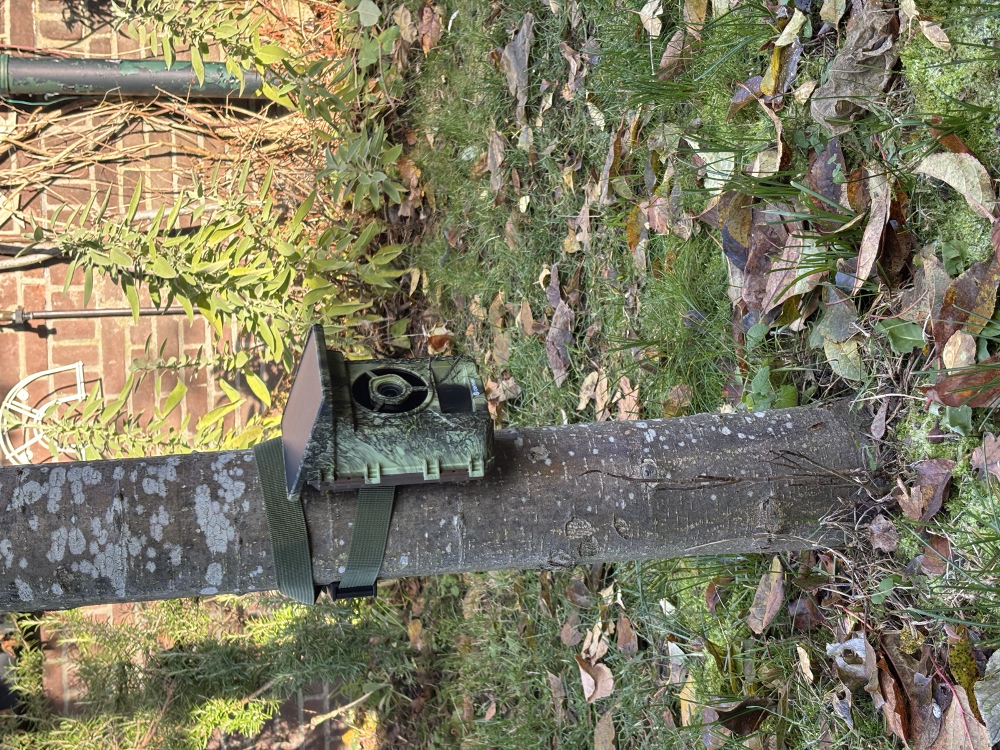
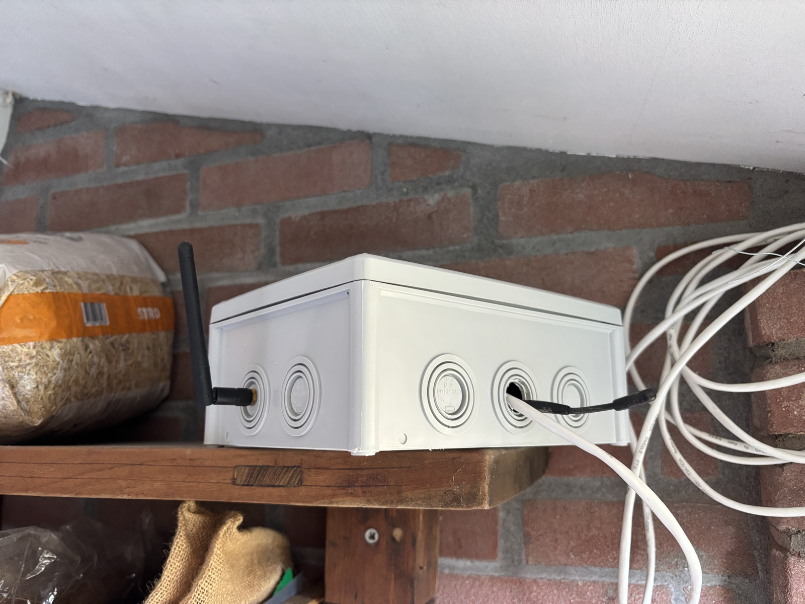
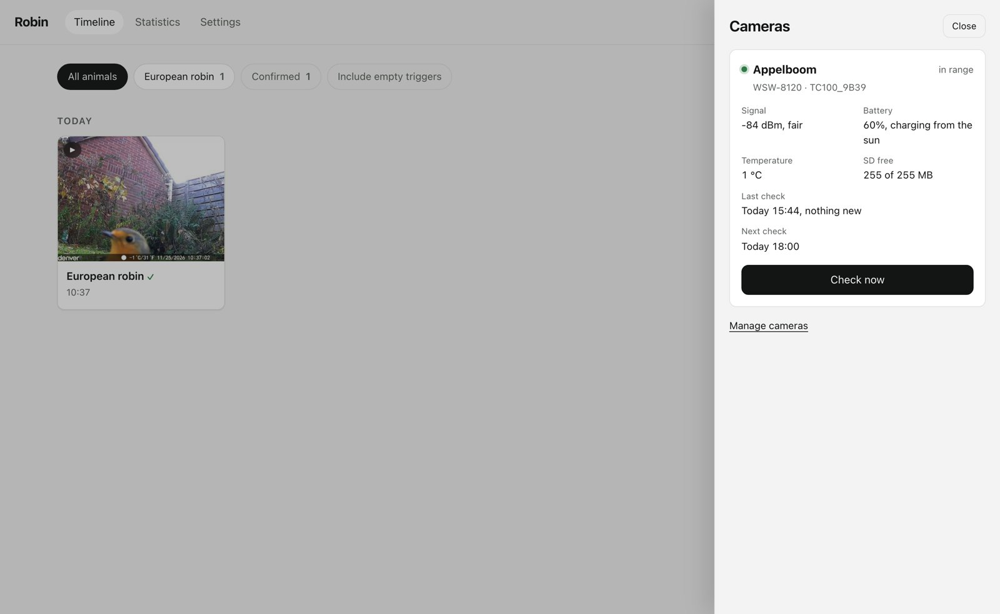

A few weeks ago I turned a 2015 Raspberry Pi into a [bird listening station](/posts/birdstation/). It sits in a weatherproof box on a shelf in the garden and streams what it hears to my home server. The server tells me which birds were singing. I was pretty happy with that.

Then I bought a trail camera.

### Marks in the grass

I'd looked at trail cameras before, but they never convinced me. They looked cheap, came with cheap apps, and getting the footage off meant walking up to the camera and fighting with that app on your phone.

Then, while building the bird station, I found an old ESP32 in a box. I'd used it about six years ago to read moisture sensors in my plant pots. Wi-Fi and Bluetooth on one chip. What if that ESP32 could talk to a trail camera itself and pull the footage off, without me ever touching the app? Then the clips could go straight to my homelab, into Robin, a small web app of mine for trail camera footage. And since the cluster was already doing the heavy lifting for the bird station, it could just as well run a few models on the clips to tell me which animal walked by.

I'd also been finding odd marks in the grass. I wanted to know what was roaming around the garden at night. The previous owners once spotted a fox here. High hopes, I know. It all came together.

I always do some research before I start a project, a sort of feasibility check, and this one was no different. I went looking for a camera that my ESP32 could easily talk to, with a rechargeable battery, okay footage, and ideally a solar panel. Geek IT Guide had already shown in [Wifi BLE Trailcam Investigation](https://geekitguide.com/wifi-ble-trailcam-investigation-part-1/) that one of these cameras wakes up when you write `BT_KEY_ON` to it over Bluetooth, and then opens a Wi-Fi hotspot of its own ([Hackaday picked it up too](https://hackaday.com/2023/07/18/reverse-engineering-reveals-hidden-api-in-abandonware-trail-camera)). Cameras from that family were the ones to look at, and I ended up with the Denver WSW-8120. It charges over USB-C and has a small solar panel on the front, so I don't have to climb into the bushes every two weeks with a box of AA batteries.



<!-- TODO Daan: what did it cost? A line like "for about €XX" fits here. -->

And the brain? That would be the ESP32 I'd dug up while building the bird station, left over from my old plant pot project. In my head it made perfect sense: Wi-Fi and Bluetooth on one chip, and another piece of old hardware with a new job. (Spoiler: I didn't do my research quite as thoroughly there.)

### On the desk

As with [HA Paper](/posts/handing-the-build-to-agents/), I started with the software. I wanted it working before anything went outside. Unlike the e-ink reader for HA Paper, which took two weeks, the camera arrived the next day, but I'd already put some code together so I could start testing right away. I gave it some charge over USB-C, put it next to my MacBook, and started taking it apart from there.

Instead of installing its app, TrailCam Go, I installed something else: [REA (Reverse Engineer Anything)](https://github.com/morluto/rea). I pointed it at the Android APK of that app, and it helped a lot in quickly figuring out the protocol and how to write software that talks to the camera. The Java side gave up the command numbers and every setting it can change, and I found the encryption key in its native library `libArLink.so`. Together with what others had found on the same family of cameras, that told me how a phone gets the video clips off:

- The camera sleeps, but keeps a little Bluetooth beacon on (mine calls itself `TC100_9B39`).
- The phone connects over Bluetooth and writes the wake-up value. The camera answers with the name and password of a Wi-Fi hotspot it just switched on.
- The phone joins that hotspot and talks to the camera over UDP, with commands as encrypted JSON: give me your status, list your files, send me this clip, delete that one, change these settings.
- The moment Bluetooth disconnects, the hotspot goes off again.

Two projects saved me a lot of guessing as well: [TrailCamHub](https://github.com/HeikoGr/TrailCamHub), which wakes these cameras from an ESP32-S3, and [trailcam-automation](https://github.com/pwnb0t/trailcam-automation), a working Python client.

By the end of it, the Mac could wake the camera, pull every clip off it, and read and change all of its settings. All that was left was to put that on the ESP32 and hang it in the garden.

### Where to store the video

That's where my research hadn't gone far enough. An ESP32 has one Wi-Fi radio, so it's either on my home network or on the camera's hotspot, never both. A clip has to sit somewhere while it switches back home, and my board has about 0.5 MB of RAM and no storage at all. A 10-second clip in 1080p is around 7 MB. I couldn't stream the clips through it to the house either, with the radio tied up on the camera's hotspot.

If only there was one device in my garden with a USB port to dump the files on, that was also on my network...

Oh. [The birdbox](/posts/birdstation/).

A Pi that's already in the garden, already on a network cable, and has three USB ports doing nothing. The ESP32 moved in with it.

```
camera ──Bluetooth + Wi-Fi── ESP32 ──USB serial── Pi 2 ──network cable── home server
```

- The **ESP32** wakes the camera over Bluetooth, keeps the connection open, joins the camera's hotspot, and from then on just passes packets. Every UDP packet from the camera goes down the USB cable to the Pi, and every packet from the Pi goes back up. It doesn't understand a byte of it and doesn't store anything.
- The **Pi** speaks the camera's protocol over that cable as if it were a network: log in, list the files, download them, glue the video and audio into an MP4, check it, and delete it from the camera.

The cable runs at 921,600 baud, about 90 KB per second on paper. In practice a 10-second clip takes a bit over two minutes to come in. The clips can wait on the camera's SD card. They only get deleted once they've come in.



The only thing that gives away the birdbox's new job is a small Wi-Fi antenna poking out of the side, which was very satisfying to mount, actually.

### One dashboard for every camera

The Pi has a small web API and waits for Robin to ask it to fetch clips.

- At set times, mostly at night, it asks the birdbox to start a session, waits until it's done, downloads the new clips and tells the Pi it can delete them. The camera's SD card never fills up.
- Every clip gets looked at by three models: Google's SpeciesNet, DeepFaune (trained on European trail camera footage) and Claude. They vote, and I can correct them. Once I've approved a clip, it stays approved.
- A side panel shows each camera with its Bluetooth signal, battery, whether the sun is charging it, temperature, free space on the card, and when it was last checked and when the next check is due. A "check now" button shows which clip is coming in.



To add a camera, I give it a name and enter the address of its bridge. A camera in the front garden would be another ESP32 next to another Pi, and its clips land in the same timeline. A cheap camera now does what the expensive ones do, and a second or third one just shows up next to it.

### Settings from a distance

I still have no idea how big the battery in this camera is. I can see the charge in steps of 20%, whether it's charging and whether the sun is doing the work. I can check all that and change settings without walking over. It also tells me the microSD card holds 255 MB, which can't be right: either I messed up formatting it, or I crammed in some ancient card. For now it's fine, since the birdbox empties it at every check.

The camera burns a bar into every clip: a Denver logo, a battery icon, the moon, the temperature and the date in American order. The command the app uses to change settings works for me as well, so the birdbox switched that bar off. Robin draws its own bar over the clip instead: the camera's name on the left, date and time in the middle (ticking along while the clip plays), and on the right the sun or the moon, the weather for that hour and the temperature. The weather comes from Open-Meteo, and the moon is the actual phase for that night. When I download a clip I can choose whether that bar gets burnt in.

### A tick in the bird recordings

The day the ESP32 moved into the birdbox, the bird stream got a faint high beep and little ticks in it.

The ESP32 was scanning for the camera's Bluetooth beacon almost all the time. It sent out requests on every scan. All that radio activity, on the same USB power as the headset that serves as the microphone, ended up in the audio. Now it listens for five seconds once a minute and sends nothing while it does. The beep is gone. There are still a few clicks, and the Pi logged an undervoltage when I plugged the ESP32 in, so a better power supply is next.

<!-- TODO Daan: check after the power supply / cable fix whether the clicks are gone, and update this paragraph. -->

### The first visitor

The first clip came in on 25 November at 10:37, while I was still busy mounting that antenna on the birdbox. A robin walked straight up to the camera and looked right into the lens, as if checking who'd moved into its garden.

<video controls muted playsinline preload="metadata" poster="/posts/birdbox-trail-camera/roodborst-poster.jpg" src="/posts/birdbox-trail-camera/roodborst.mp4" style="width:100%;border-radius:8px"></video>

That clip came in just before the birdbox switched off the camera's own bar, so it's still burnt in. The models said "bird, 98%". I filled in the rest. The app was still called Wildcam then, which was a bit of a lame name. It's called Robin now.

Next up is a second camera, and a real microphone for the birdbox, so it hears the birds better than it hears the ESP32.
