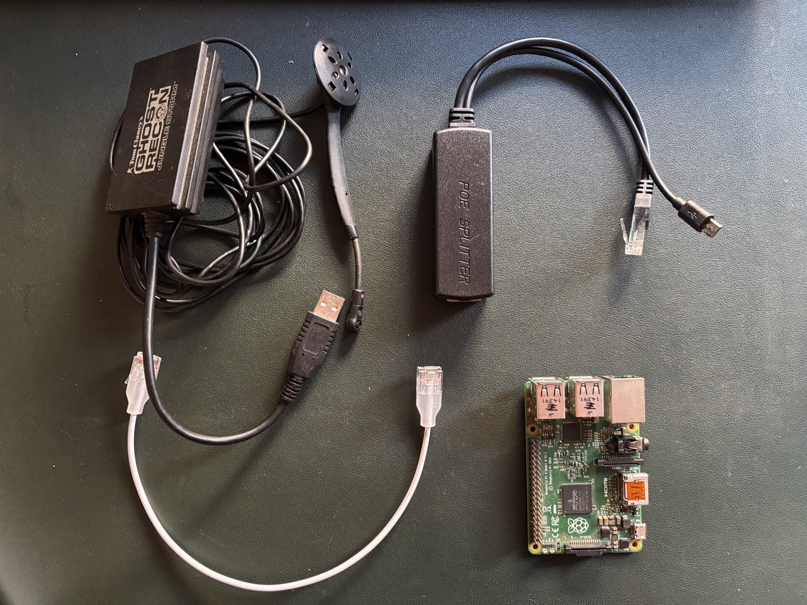
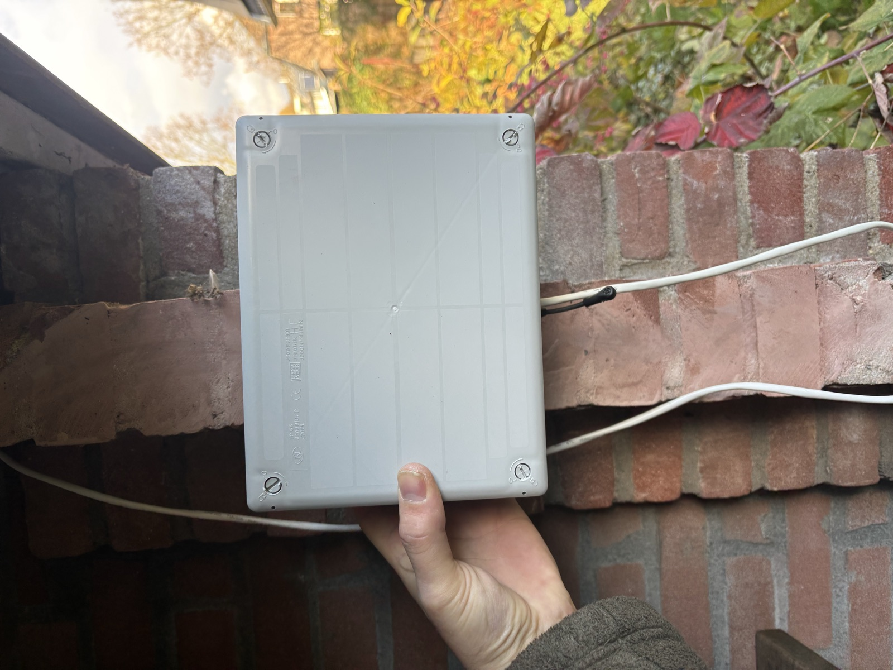
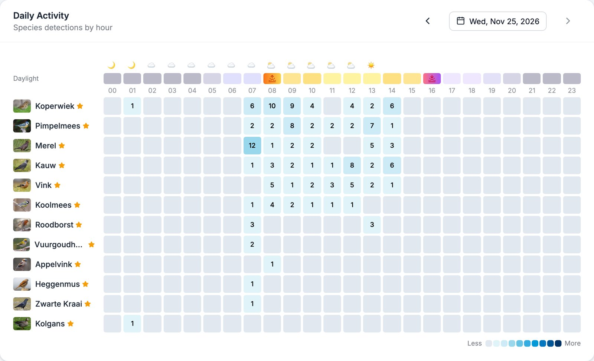

It started with [Avian Visitors](https://theodore.net/projects/AvianVisitors/). That post made me realise the BirdNET model weights are open source, and that got me excited to do something with them myself. I knew the Cornell Lab of Ornithology, of course, the people behind the fantastic Merlin Bird ID app. I still use it sometimes when I'm out birding, for a second opinion.

[BirdNET](https://birdnet.cornell.edu/), a neural network from the Cornell Lab and Chemnitz University of Technology, recognises thousands of species by sound, and projects like BirdNET-Pi turn a Raspberry Pi into a bird listening station. But they run the analysis on the Pi itself, so you need a Raspberry Pi 4 or 5, a decent microphone, maybe a fan, and a few hundred euros before you've heard a single robin.

Spending all that on a Raspberry Pi at today's inflated prices, just to listen to birds, felt like a bit much. It's not like I have piles of gold lying around. What I do have is piles of old electronics. So, almost in the spirit of Scrapyard Wars, I went through my stash and came out with a Raspberry Pi 2, a microphone and a PoE splitter. (If this had been Scrapyard Wars, I'd have dug up a "rusty" Raspberry Pi 5 that turned out to be brand new.)

### The junk pile

- A **Raspberry Pi 2 Model B** from 2015. Four slow ARM cores, 1 GB of RAM, no Wi-Fi, no Bluetooth.
- A **PoE splitter**: network cable in, micro-USB power out. One cable for both.
- A **Logitech USB headset** that came free with Ghost Recon: Jungle Storm on the PlayStation 2. I don't think I ever used it for the game. During covid it became my favourite headset for calls, until a webcam with a built-in mic made it redundant. It's a voice mic, so hardly the thing you'd take out to record birdsong. Still, it's had a long life, and here was another job for it.
- A **32 GB microSD card** that still had a Proxmox installer on it.

<!-- TODO Daan: the EM272 microphone and Sound Blaster Play! 3, from a box or bought? That decides how strict the "buy nothing" line is. -->

The Pi 2 was probably the weak spot, and unfortunately BirdNET-Go's own documentation calls it "marginal and RAM-limited". Sad, but true. It's already impressive that a deep learning model can run on cheap hardware at all. Then I realised my Pi 2 didn't have to do the analysis. I have a much more powerful homelab, and the only thing the Pi had to do for me was record. That changed things, and gave me hope.

Luck was on my side, because BirdNET-Go already supports exactly that. The same page says the Pi 2 "works well as a dedicated RTSP mic feeding a Pi 4/5 that does the inference". I don't have a Pi 5, but I do have a homelab: a small Kubernetes cluster that runs all sorts of services, with a 16-core mini PC as one of its nodes.

### Splitting the ear and the brain

So the Pi became the ear and the cluster the brain. The cluster pulls the stream from the Pi, runs BirdNET, keeps the detections and short audio clips, and tells Home Assistant what it heard.

On the Pi it's all off-the-shelf software. ffmpeg reads the microphone, and MediaMTX, a tiny media server, serves the audio as an RTSP stream, the same protocol IP cameras use. The Pi doesn't even know the cluster exists. If the stream drops, the cluster just reconnects.

I send uncompressed mono audio at 16-bit and 48 kHz. That's about 770 kbit/s, which is nothing for a home network. MP3 and friends save bandwidth by throwing away the high frequencies, and that's exactly where a lot of birdsong lives.

Because the Pi only copies samples and never encodes or analyses anything, the 2015 board barely notices. ffmpeg takes about a quarter of one core, and the load sits around 1 out of 4. The Pi uses 147 MB of its 920 MB of RAM, and it stays at 32 °C.

### Built to be unplugged

Someone's going to pull the cable sooner or later (that'll be me), reboot the PoE switch (also me), or flip the wrong fuse and cut the power to the Pi (yes, most likely me). And when that happens mid-write, the microSD card is toast. That's why I have a difficult relationship with the early Raspberry Pis. Well, life teaches you these hard lessons, so this time I set the system up to run read-only. The OS runs from an overlay in RAM, the logs live in RAM, and there's no swap. Nothing gets written to the card in normal use, so you can pull the plug whenever you like.

<!-- TODO Daan: result of the power-cut test. -->

The headset is a stopgap, and I wanted to plug in a real microphone later without rebuilding anything. The setup picks the sound card by name instead of by number and picks the best sample rate it supports. I was surprised the headset records natively at 48 kHz. A minute of the live stream showed no clipping, low rumble from wind and traffic, and a 50 Hz hum from its cable. Luckily no birds live down there, so BirdNET-Go's high-pass filter takes that out for free. For faint flight calls high in the night sky, I'll need a proper microphone.

I was a bit lazy here, too. I wanted to write the SD card, plug in the Pi and SSH straight into it with most of it already set up. I've always hated the usual Raspberry Pi fiddling: an HDMI cable to a monitor, a keyboard, cables everywhere, and a USB charger that's always just too short, so you end up with the Pi on your lap, being drawn and quartered by its own cables.

So everything is scripted. One script writes the SD card, and the Pi comes up on the network ready to log in. An Ansible playbook does the rest. And when I break the card anyway (and we both know I will), a new one is fifteen minutes away.

It now lives in a white weatherproof box in the garden, on its one network cable, with the headset's microphone poking out of the bottom. I've started calling it the birdbox.

### What it hears

The cluster runs [BirdNET-Go](https://github.com/tphakala/birdnet-go), an open-source rewrite of BirdNET-Pi. It has a web interface with a live spectrogram, a list of detections with their audio clips, and an MQTT connection to Home Assistant, where a "BirdNET-Go" device shows the last species, its scientific name and how sure it is. That makes it easy to get a notification on my phone when it hears a species it hasn't heard before.

The first real detection came the same afternoon: a great tit, at 97 to 99%.

A microphone in the garden also hears the neighbours and anyone walking past. I only save short clips around detections. A speech detector throws out any clip with a human voice, and the rest are deleted after two weeks.

### Two models walk into a garden

BirdNET comes in two flavours: the classic v2.4 and the newer v3.0 with a regional model for Central Europe. At first I ran both on the same stream and let them merge their detections. Two models agreeing sounded like a good sign.

Then I went through 156 detections by hand and marked each one right or wrong. That's where years of birding came in handy. I know a lot of calls, so confirming or rejecting a detection went quickly, and that made it easy to see how well each model really did. It was fun too, because I'd never spent that much time just listening carefully. Sometimes I had to look up a variation of a call, and I got to know some birds better along the way. Of the ones only v2.4 heard, 8% were right. Of the ones only v3.0 heard, 60% were right. When it was at least 70% sure, that went up to 92%. So v3.0 on its own beat both v2.4 and the two together. I dropped v2.4 and kept v3.0 at a 70% threshold, which also saved the cluster a CPU core.

v3.0 also knows frogs, grasshoppers, crickets and bats, but I switched most of those off, because they popped up on every weird noise.

### Why it couldn't hear an ortolan

BirdNET knows about 6,500 species, but it doesn't listen for all of them. A "range filter" first picks the species that are plausible for your location and the current week. Everything else is ignored, no matter how clearly it sings.

I was curious about night migrants. On autumn nights thousands of birds fly over, calling to keep in touch, and a microphone pointed at the sky can pick them up. The ortolan bunting is a classic one. So I asked the range filter for its score in every week of the year. The highest was 0.0011, and the cut-off was 0.01. An ortolan could fly right over the microphone and the system would never say so. The same went for the nightjar, which breeds on the heath a few kilometres away.

I checked the filter against five years of records from waarneming.nl, the Dutch observation platform. That's 17,333 bird observations of 181 species in the Renkum area. Even the long-eared owl would have been blocked in 51 of its 69 recorded sightings.

Those records leave some birds out. waarneming.nl hides observations of sensitive species like owls and nesting raptors to protect them, so the birds you'd most like to catch are exactly the ones the data hides.

The fix was the newer range model with a different cut-off, chosen so it only blocks 6 of those local observations, all out of season. I also let through 16 Dutch rarities the model would always rule out. For those, I set the confidence threshold to 85% (70% for the rest). Catching a rarity is the whole fun of a device that listens day and night, but that's also where BirdNET makes most of its mistakes.

The range model thought an American red squirrel and a trumpeter swan were just plausible enough for a Dutch village. Those went on an exclude list by hand.

### So far

On a grey Wednesday in November it heard thirteen species, from redwings passing through to the robin that walked up to a trail camera that same morning.

My favourite so far is a firecrest. It showed up on four days in its first week, and one morning BirdNET was 95% sure of it.

It didn't stay a bird station for long, though. A cheap trail camera moved in next to it, and an old ESP32 in the same box now empties that camera too. You can read all about that [here](/posts/birdbox-trail-camera/).
