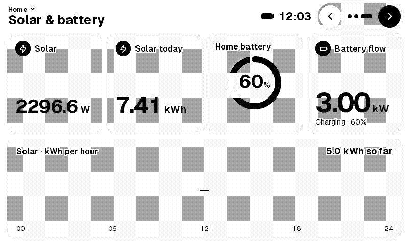

Home Assistant has run my house for years. It knows the energy price for the next hour, what the solar panels are doing, and how warm every room is. To see any of that I pick up my phone or open a dashboard on a tablet. Both light up the room in the evening, and both have every other app one swipe away.

What I wanted was a small display on a shelf that shows those numbers and nothing else. E-ink, so it is readable in daylight and dark at night. Every time I looked into it I ended up at the same place: a bare panel, an ESP32 board and a 3D-printed case. That is a fine weekend project, but not something I want in my living room.

<!-- TODO Daan: the 3D-printed-case reason comes from your brief, not from the project docs. Confirm or rephrase in your own words. -->

So two weeks ago I started HA Paper: firmware that turns an Xteink X4 Pro e-reader into a Home Assistant dashboard. The first public beta is v0.2.0-beta.1, and the code is at [github.com/daangeijs/ha-paper](https://github.com/daangeijs/ha-paper).

<!-- TODO Daan: check the repo URL and the beta tag are live before publishing. -->

<!-- IMAGE: photo of the X4 Pro on the shelf showing the Home page, Daan to add -->

### An e-reader instead of a DIY panel

The idea came from work. A few colleagues had an Xteink X4 Pro, and one of them, [COLLEAGUE NAME], told me you can replace its operating system quite easily. He showed me what he had built himself: [HIS PROJECT NAME + LINK], his own firmware for reading books on the go, which also plays chess. If it can play chess, it can show my energy prices.

<!-- TODO Daan: fill in [COLLEAGUE NAME] and [HIS PROJECT NAME + LINK], and check he is fine being named. -->

The X4 Pro is a 4.3-inch e-reader that costs about a hundred euros. Inside is an ESP32-S3 with 16 MB of flash and 8 MB of PSRAM, an 800 × 480 e-ink panel with a touch controller, a front light and a battery. It comes with a proper case, buttons and a magnetic USB-C cable. It looks like something you bought on purpose, which is most of what I was after.

What makes it usable is that the bootloader isn't locked. An open-source reader firmware, [CrossPoint](https://github.com/crosspoint-reader/crosspoint-reader), already runs on it. Its hardware library, freeink-sdk, has a pin map and display drivers that its authors checked on real devices. HA Paper pulls that library in as a submodule, so we never wrote a driver for the panel or the touch chip.

There were two catches. I didn't have the device yet; it arrived two weeks after the first commit. And I wasn't going to write the firmware myself.

### Handing the build to a team of agents

Claude Code wrote the code. I set the project up the way I would set up a small team, and on day three it looked like this. Every piece of work is a GitHub issue. A GitHub Project board holds them with a status, a priority and a size, and the milestones are the releases. I also wrote down what the thing is for: easy to install, easy to set up, easy to configure, a connection that stays up, long battery life, and a calm object that looks good in the house. Every plan gets judged against that list.

The main Claude Code session is the coordinator. It owns the board and hands work to subagents, each with one job:

- **Discovery agents** read other people's code (CrossPoint, TRMNL, Home Assistant's own sign-in code, datasheets) or dig into a stuck issue, and post what they find on the issue.
- **Builders** take one issue each, in their own git worktree, with their own pair of emulator ports. Four or five can test at the same time without testing each other's firmware.
- **Reviewers** audit merged work for security, concurrency and flasher safety before a release. In the first audit one of eleven findings was real, so the coordinator checks each finding before anyone acts on it.
- **A council** of three strategy agents (product, onboarding, visual design) proposes themes and issues before each sprint. The coordinator decides. Anything that is my call gets a `decision` label and a question instead of a guess.
- **A writer** keeps a build log in the repo.

Every change reaches `main` through a pull request. Builders leave their work uncommitted and report back. The coordinator commits, opens the PR, runs the full test list and merges. In two weeks that added up to 134 issues and 88 merged pull requests.

I am the product owner and the only user. Anything with a visible change gets a `verify` label and a short "how to verify", and before each release I get one checklist of at most ten items to try on a test device. My corrections were mostly one or two sentences. The coordinator built "roll back a firmware update if it can't reach Home Assistant". I pointed out that updates come from GitHub, so a Home Assistant outage should never undo a good update. The default screens turned out to be my own house, with my meters and my rooms. I asked that a fresh display builds its screens from the owner's Home Assistant instead.

### Two weeks of emulators

Without hardware, everything ran in emulators.

The first one was a design: an interactive mock-up made in Claude Design, with the device screen, a web console and a panel of "what if" switches (never linked, Home Assistant token revoked, a broken firmware download). It became the specification. Its config parser generated test cases, and the C++ firmware has to give the same answer for each one: same line number, same error message.

The second was the real firmware in Espressif's QEMU fork, which emulates the ESP32-S3 on a Mac. It has no Wi-Fi and no e-ink panel, but it does emulate the CPU, flash, PSRAM and an Ethernet controller. That is enough to run the web server, the API, the Home Assistant connection and firmware updates against a fake Home Assistant with OAuth, a WebSocket, TLS and faults on purpose. The contract suite that runs against it is now 88 tests.

It found two bugs that every unit test had passed. Firmware rollback had never worked: the function that tells Arduino to wait before trusting a new image was declared in C++ instead of C, so the linker never matched it and every update was accepted on first boot. The fix was two words, `extern "C"`. And Home Assistant sends its entity list as one 74 KB string, while the JSON library on a 32-bit chip caps a string at 65,535 bytes. On a big house the list came back empty.

On top of that runs an endurance harness: the firmware in QEMU for a full day while it injects Home Assistant restarts, dropped WebSockets, a two-hour clock jump and network drops. The run before v0.1.0-alpha.6 did 1440 polls with 273 injected faults, recovered from every one within 94 seconds, and the heap stayed flat. We shipped six alpha releases before the device existed.

### It booted on the first try

The X4 Pro came in at midnight on 26 October. The plan was boring on purpose: check that the chip isn't locked, back up the full 16 MB of stock firmware (53 seconds, checked four ways), flash.

It booted, joined Wi-Fi and linked to my Home Assistant on the first try.

### What the emulators could not show

Then I used it for a while and wrote down what I saw. None of it had shown up in QEMU, which has no panel, no radio, and a Mac's CPU underneath.

- **Every page change flashed three or four times.** Navigation used the full refresh waveform: 77 full refreshes in 23 minutes of use.
- **A clock tick turned the screen black.** The panel controller keeps two RAM planes and compares them on every partial refresh, even for a one-line window. The driver left gray data in one of them, so a clock update drove every pixel where the planes differed.
- **The internal heap fell to 10.9 KB.** QEMU had shown about 117 KB. The Wi-Fi driver asks for 64 buffers in internal RAM, and QEMU's Ethernet card never does.
- **Every boot showed the setup screens**, three full refreshes before Home. The real panel's boot refresh takes longer than a 1.6-second timer, so the app decided it was a new display before the stored Wi-Fi settings had loaded.
- **The text was too small.** 14 px on this panel is about 1.1 mm. The browser preview scales the image up, and for two weeks that hid it.
- **It was slow.** A tap cost 1.7 seconds of panel refreshes (565 ms to invert the pressed button, 1092 ms for the new page) before the render time was even added. Rendering the Home page took 7.8 seconds; on my Mac the same code takes about 2 ms. The worst I saw was 22.6 seconds for one page change, while I kept tapping, and every extra tap was queued and replayed afterwards.

A discovery agent found the cause of the last one. The rounded corners of every card were computed with `double` math, per pixel. The ESP32-S3's FPU only does single precision, so every one of those operations became a software call.

Later that day I pressed the power button, and the device switched off so hard that only plugging in USB brought it back.

### Back to a display I want to use

I went to bed and left the device on USB. The coordinator flashed each fix overnight, read the device's log, and only then merged the pull request. By the morning four were merged. Navigation uses the fast waveform and only every tenth page change does a clean refresh. The clock fix is one extra 48 KB write to the controller's RAM after each gray render. The heap low point went from 7.6 KB to 23.9 KB. The display boots straight to Home. The larger text waited until I could look at it on the glass.

The speed was fixed by the next afternoon. A builder rewrote the drawing code in integers, and all 408 host renders came out byte-identical to before. Home now renders in 262 ms, and a tap shows the new page in about one second, most of which is the panel's own waveform. To measure that without me tapping, I asked for two API endpoints: one that injects input, one that returns the framebuffer. From then on the coordinator paged through the screens itself and read the timings from the log. My verdict after trying it: "speed is now perfect".

The screenshots in this post come from that framebuffer: 800 × 480 pixels in four gray levels, the same image that is on the glass.

This is what the beta does now.

**Setup.** You flash it from a web page in Chrome or Edge over USB. The page checks that the chip isn't locked, saves the full stock backup to a file so you can always go back, and installs without touching the partition where the factory stored the panel calibration. Then it sends your Wi-Fi name and password over the same cable with [Improv](https://www.improv-wifi.com/serial/). Without the cable you pick a network on the display, or join a setup hotspot from your phone.

**Sign-in.** Most ESP32 Home Assistant projects ask you to paste a long-lived token. HA Paper shows a QR code and its address on the display. Scan it, press *Sign in with Home Assistant*, and log in with your normal account. It is a regular OAuth sign-in, and a discovery agent read Home Assistant's source first to make sure it works without the display needing a public hostname. After the first link, the display builds its screens from what your Home Assistant has: the energy dashboard, rooms, lights, climate.

<!-- IMAGE: photo of the display showing the sign-in QR code, Daan to add -->

**The web console.** The device serves its own web console. You edit screens and tiles with live values next to them, change device settings, edit the YAML directly if you prefer, and create API tokens. A Home Assistant admin gets full access; any other user gets a view-only console.

<!-- IMAGE: screenshot of the web console screen editor, Daan to add (check no entity names or hostname are visible) -->

**Updates.** Firmware goes in over the API. The device checks the upload against the SHA-256 in the release manifest, writes it to the other of two app slots and boots it. A new image is kept once it has run for a minute with a network connection. If it crashes before that, the bootloader goes back to the old one. If it hangs, it restarts itself after 12 minutes and rolls back. If it can't get online within ten minutes, it rolls back as well, because an image that can't get online can never be fixed over the air. Once the repository is public, the device can also check GitHub releases on its own.

**An API for agents.** The API is meant for scripts and agents as well as for me. API tokens are read or write. `/status`, `/diagnostics` and `/logs` show what the device is doing: the last eight boots and why they happened, the heap low point, a 64 KB log ring in PSRAM, and the tail of the log from before the last reset. Remote input and the framebuffer are off by default and switched on in the settings. These are the endpoints the coordinator used on the real device that night.

### What changed for me

The emulators gave me firmware that booted, linked and drew the right things on its first flash. They could not show waveforms, the controller's RAM, the Wi-Fi driver's memory or how long the real panel takes to refresh, and every bug of the first night was one of those. Next time I would build the emulators first again, and plan a night with the real device.

The agent team needed what a human team needs: one place for the plan, small pieces of work, someone who decides, and a user who uses the thing every day. Most of my value was in that last role. The difference with a human team is the pace. Bugs I found at midnight were flashed, checked and merged by the time I woke up. I didn't expect an agent to flash a device on my desk, read its log, tap it through the API and check its framebuffer, and then fix what it saw.

It is not finished, and the beta is public so other people can find what I haven't:

- **Battery life is not measured.** On paper, glance mode (deep sleep, a wake every 15 minutes) lasts about 50 days, but that uses [TRMNL](https://usetrmnl.com)'s published numbers, not ours.
- **The power button** still cuts the power in a way only USB undoes. That is the top priority.
- **One overnight soak stopped answering** over HTTP for 55 minutes without resetting itself. Not explained yet.
- **Text sizes just changed.** I approved the larger sizes on the device for the beta. They need a few days of living with.
- **The browser flasher has not run against a real X4 yet.** So far only the backup and flash from the repo have.

<!-- TODO Daan: update this list against the board on the day you publish (#225 power button, #227 HTTP stall, #205 text sizes, flasher on hardware). -->

This post was drafted by the project's writer agent from its own build log, and edited by me.

<!-- TODO Daan: confirm this sentence matches how you edited the post, or rewrite it. -->
