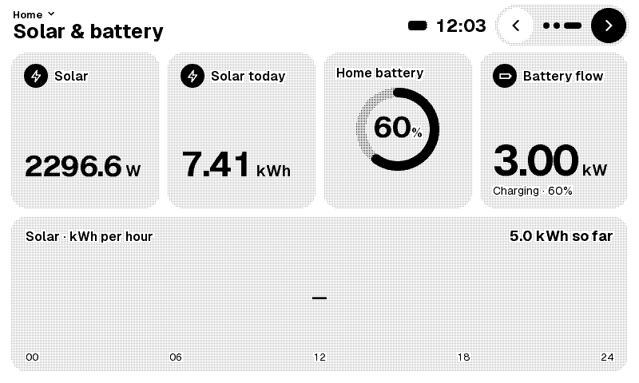
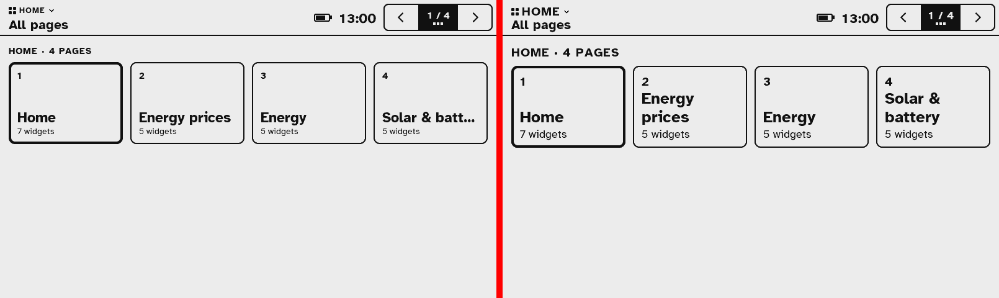

Home Assistant has run my house for years. To see what it knows (the energy price, the solar panels, the temperature in every room) I pick up my phone or open a dashboard on a tablet. Both light up the living room in the evening, and both have every other app one swipe away. I wanted a small e-ink display on a shelf that shows those numbers and nothing else.

The hardware idea came from work. A few colleagues had an Xteink X4 Pro, a 4.3-inch e-reader of about a hundred euros, and one of them, [COLLEAGUE NAME], told me you can replace its software quite easily. He showed me his own firmware, [HIS PROJECT NAME + LINK], for reading books on the go. It also plays chess. If it can play chess, it can show my energy prices.

<!-- TODO Daan: fill in [COLLEAGUE NAME] and [HIS PROJECT NAME + LINK], and check he is fine being named. -->

That became [HA Paper](/projects/ha-paper/), firmware that turns the X4 Pro into a Home Assistant display. What it does is on the project page. This post is about how it got built, because I wrote almost none of the code.

I also didn't have the device yet. It arrived two weeks after the first commit.

What I did have was an opinion about how it should be built. My day job is product discovery, and I have fairly fixed ideas about how a team should work: someone with clear goals, discovery before building, small pieces of work anyone can pick up, checks on every change, and a real user who tries each release. I wanted to see what happens if you take that literally and let Claude Code play every role except product owner and user, which I kept for myself.

### A team on a board

By day three the project looked like a small team's. Every piece of work was a GitHub issue on a project board, with a status, a priority and a size, and the milestones were releases. I wrote down what the thing is for: easy to install, easy to set up, a connection that stays up, long battery life, and a calm object that looks good in the house. Every plan got held against that list.

The main Claude Code session was the coordinator, more or less the team lead. It owned the board and handed work to subagents, each with one job:

- **Discovery agents** read other people's code (CrossPoint, TRMNL, Home Assistant's own sign-in, datasheets) or dug into a stuck issue, and posted what they found on the issue before anyone started building.
- **Builders** took one issue each, in their own git worktree with their own emulator ports, so four or five could test at once without testing each other's firmware.
- **Reviewers** audited merged work for security, concurrency and flasher safety before a release. In the first audit, one of eleven findings was real, so the coordinator now checks every finding before anyone acts on it.
- **A council** of three agents (product, onboarding, visual design) proposed themes and issues before each sprint. The coordinator decided, and anything that was my call got a `decision` label and a question instead of a guess.
- **A writer** kept a build log in the repo. This post started there.

Every change went through a pull request. Builders left their work uncommitted and reported back; the coordinator committed, opened the PR, ran the tests and merged. After two weeks that was 134 issues and 88 merged pull requests.

The rules the agents worked by weren't mine. Every time something went wrong, the coordinator added a rule to the project's instructions file, with the date and what had happened, the way a team's working agreements grow. Early on, two builders tested at the same time on the same simulated device, and each thought it was looking at its own work. From then on every builder got its own simulator.

Anything with a visible change got a `verify` label with a short "how to check", and before each release I got a list of at most ten things to try. Work merged on the automated checks without waiting for me, except copy and design, which I wanted to see first.

My own part was mostly product calls of a sentence or two. The agents could only see my house, so the first version showed my meters and my rooms on every screen: perfect for me, useless for anyone else. I said a new display should build its screens from its owner's Home Assistant, and that became the next piece of work.

### Two weeks of emulators

With no hardware, everything ran in emulators.

The first was a design: an interactive mock-up made in Claude Design, with the device screen, a web console and a panel of "what if" switches (never linked, token revoked, a broken firmware download). That mock-up ended up being the spec. Its config parser generated test cases, and the C++ firmware has to give the same answer for every one of them, down to the line number and the error message.

The second was the real firmware in Espressif's QEMU fork, which emulates the ESP32-S3 on a Mac. No Wi-Fi and no e-ink panel, but the CPU, flash, PSRAM and an Ethernet controller are there. That's enough to run the web server, the API, the Home Assistant connection and firmware updates against a fake Home Assistant that fails on purpose. The test suite against it is 88 tests now, and a copy of the firmware in QEMU, linked to my real Home Assistant, was my test device for two weeks.

It found two bugs every unit test had missed. Firmware rollback had never worked: one function was declared in C++ instead of C, so the linker never matched it and every update was trusted on first boot. The fix was two words, `extern "C"`. And Home Assistant sends its list of entities as one 74 KB string, while the JSON library on a 32-bit chip stops at 65,535 bytes, so on a big house the list came back empty.

On top of that ran an endurance test: the firmware in QEMU for a full day, with Home Assistant restarts, dropped connections, a two-hour clock jump and network drops thrown at it. The run before the sixth alpha did 1440 polls with 273 faults, recovered from every one within 94 seconds, and the memory stayed flat. Six alpha releases went out before the device existed. Those runs also turned up a 55-minute stall over HTTP. It turned out to be name lookups: the device's `.local` name stopped answering while it was fine by IP address. It answers IPv6 lookups too now, and the name has kept working since.

### First flash

The X4 Pro arrived at midnight on 26 October. I kept the plan dull: check that the chip isn't locked, back up the full 16 MB of stock firmware (53 seconds, checked four ways), flash.

It booted, joined Wi-Fi and linked to my Home Assistant on the first try.

### What QEMU couldn't see

Then I used it for an evening and wrote down what I saw. None of it had shown up in the emulator, which has no panel, no radio and a Mac's CPU underneath.

- Every page change flashed three or four times. Navigation used the full refresh: 77 of them in 23 minutes.
- A clock tick turned the screen black. The panel controller compares two memory planes on every partial refresh, and the driver left grey data in one of them.
- Free memory dropped to 10.9 KB. QEMU had shown about 117 KB. The Wi-Fi driver claims 64 buffers on the real chip, and QEMU's Ethernet never does.
- Every boot showed the setup screens. The real panel's first refresh takes longer than a 1.6-second timer, so the app decided it was new before it had read its Wi-Fi settings.
- The text was too small. 14 px on this panel is about 1.1 mm. The browser preview scales the image up, and for two weeks that hid it.
- It was slow. Drawing the Home page took 7.8 seconds; the same code takes about 2 ms on my Mac. The worst page change I saw took 22.6 seconds, while I kept tapping, and every extra tap got replayed afterwards.

A discovery agent found the cause of that last one. The rounded corners of every card were computed with `double` maths, per pixel, and the chip's floating-point unit only does single precision, so every one of those became a slow software call.

Later that evening I pressed the power button and the device switched off so hard that only plugging in USB brought it back.

### Overnight

I went to bed and left the device on USB. The coordinator flashed each fix, read the device's log, and only then merged the pull request. By morning four were in.

<!-- TODO Daan: what did you see when you picked it up that morning, and the first tap that felt fast? A line or two here would make this the best moment of the post. --> Navigation uses the fast refresh and only every tenth page change does a clean one. The clock fix is one extra write to the controller's memory. Free memory went from 7.6 KB to 23.9 KB at its lowest. The display boots straight to Home. The bigger text waited until I could look at it on the glass.

The power button took a day and wasn't a bug at all. The button on the top edge, next to the microSD slot, is Reset; Xteink's quick start guide says so. On battery, a reset restarts the chip, the chip lets go of the line that keeps the power on, and the device stays off until you hold the real Power button on the right side. The stock firmware does exactly the same.

The speed was fixed by the next afternoon. A builder rewrote the drawing code in whole numbers, and all 408 test renders came out identical to the pixel. Home now draws in 262 ms, and a tap shows the new page in about a second, most of which is the panel itself.

To measure that without me tapping, I asked for two API endpoints: one that injects a tap and one that returns what's on the screen. With those, the coordinator paged through the screens itself, read the timings from the log and looked at the result. My verdict after trying it: "speed is now perfect".

The screenshots here come from that endpoint: 800 × 480 pixels in four shades of grey, the same image that's on the glass. Below is how I approved the bigger text: two of those side by side, then a look at the device on the shelf.

### After the first week

The emulators gave me firmware that booted, linked and showed the right things on its first flash. What they couldn't show was everything physical: the refresh behaviour, the controller's memory, the Wi-Fi driver, how long the real panel takes. Every problem of that first evening was one of those. Next time I'd build the emulators first again, and plan an evening with the real device much earlier.

The team setup held up better than I expected. The difference was speed: from "I see a bug" to "fix flashed, checked on the device and merged" took one night.

What I still did myself was what I'd call product ownership anyway: the goals, the calls marked `decision`, copy and design. The few times the project really needed a person were things only someone in the room could do. Plug in the hardware, press the power button, look at 14 px text from a metre away and say it's too small.

I don't know how far this carries beyond one person and one user. But an agent flashed a device on my desk, read its log, tapped through it and fixed what it saw, and I didn't expect that.

Some of it is still rough:

- Some numbers come from paper. The battery estimate comes from a power model, and nobody has put a current meter on the device yet.
- One crash is unexplained. An older build stored a crash dump from the network name service on my network, and it couldn't be decoded. We're waiting to see if it comes back on a build that can be.
- The emulator job in CI is flaky. On GitHub's runners a different test times out each run, and a rerun passes.
- The web flasher has only run against my own X4.

<!-- TODO Daan: the "my day job is product discovery" framing and the "Looking back" section are written from your brief; check they say what you think, in your words. -->

This post was drafted by the project's writer agent from its own build log, and edited by me.

<!-- TODO Daan: confirm this sentence matches how you edited the post, or rewrite it. -->
