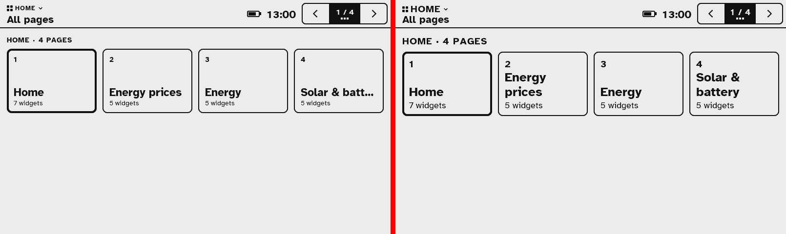

Home Assistant has run my house for years. To see what it knows, the energy price, the solar panels, the temperature in every room, I pick up my phone or open a dashboard on a tablet. Both light up the room in the evening, and both have every other app one swipe away. I wanted a small e-ink display on a shelf that shows those numbers and nothing else.

The idea for the hardware came from work. A few colleagues had an Xteink X4 Pro, a 4.3-inch e-reader of about a hundred euros, and one of them, [COLLEAGUE NAME], told me you can replace its operating system quite easily. He showed me what he had built himself: [HIS PROJECT NAME + LINK], his own firmware for reading books on the go, which also plays chess. If it can play chess, it can show my energy prices.

<!-- TODO Daan: fill in [COLLEAGUE NAME] and [HIS PROJECT NAME + LINK], and check he is fine being named. -->

That became [HA Paper](/projects/ha-paper/), firmware that turns the X4 Pro into a Home Assistant dashboard. The first public beta is v0.2.0-beta.1. What it does is on the project page. This post is about how it was built, because I wrote almost none of the code. HA Paper is the first project I built this way.

<!-- TODO Daan: check the repo is public and the beta tag is live before publishing. -->

There were two catches. I didn't have the device yet; it arrived two weeks after the first commit. And I wasn't going to write the firmware myself. I had an opinion about how it should be built, though. My day job is product discovery, and I have fairly fixed ideas about how a product team should work: a product owner with clear goals, discovery before building, small pieces of work that anyone can pick up, checks on every change, and a real user who tries each release. I wanted to see what happens if you take that literally and let Claude Code play every role except two.

### Handing the build to a team of agents

So I set the project up the way I would set up a small team, and on day three it looked like this. Every piece of work is a GitHub issue. A GitHub Project board holds them with a status, a priority and a size, and the milestones are the releases. I wrote down what the thing is for: easy to install, easy to set up, easy to configure, a connection that stays up, long battery life, and a calm object that looks good in the house. Every plan gets judged against that list.

The main Claude Code session is the coordinator, in effect the team lead. It owns the board and hands work to subagents, each with one job:

- **Discovery agents** read other people's code (CrossPoint, TRMNL, Home Assistant's own sign-in code, datasheets) or dig into a stuck issue, and post what they find and a proposal on the issue. Building starts after that.
- **Builders** take one issue each, in their own git worktree, with their own pair of emulator ports. Four or five can test at the same time without testing each other's firmware.
- **Reviewers** audit merged work for security, concurrency and flasher safety before a release. In the first audit one of eleven findings was real, so the coordinator checks each finding before anyone acts on it.
- **A council** of three strategy agents (product, onboarding, visual design) proposes themes, exit criteria and issues before each sprint, like a planning session. The coordinator decides. Anything that is my call gets a `decision` label and a question instead of a guess.
- **A writer** keeps a build log in the repo. This post started there.

Every change reaches `main` through a pull request. Builders leave their work uncommitted and report back. The coordinator commits, opens the PR, runs the full test list and merges. In two weeks that added up to 134 issues and 88 merged pull requests.

Most of the rules in the project's instructions file have a date and an incident next to them, the way a team's working agreements grow. Two test runs on one emulator port made the contract suite test the wrong firmware image, so every builder now gets its own port pair. One agent updated the shared PlatformIO toolchain and broke every parallel build for minutes, so toolchain changes go in a private directory. The agent git guard tripped halfway through commits, so builders stopped committing. Main was red for two days before anyone noticed, so the coordinator now checks the main build after every merge and no release is tagged while it is red.

I kept two roles: product owner and user. Anything with a visible change gets a `verify` label and a short "how to verify", and before each release I get one checklist of at most ten items to try on a test device. Work merges on the automated checks and doesn't wait for me, except for copy and design, which I asked to see first. My corrections were mostly one or two sentences. The coordinator built "roll back a firmware update if it can't reach Home Assistant". I pointed out that updates come from GitHub, so a Home Assistant outage should never undo a good update. The default screens turned out to be my own house, with my meters and my rooms. I asked that a fresh display builds its screens from the owner's Home Assistant instead. Both are product calls, not code.

### Two weeks of emulators

Without hardware, everything ran in emulators.

The first one was a design: an interactive mock-up made in Claude Design, with the device screen, a web console and a panel of "what if" switches (never linked, Home Assistant token revoked, a broken firmware download). It became the specification. Its config parser generated test cases, and the C++ firmware has to give the same answer for each one: same line number, same error message.

The second was the real firmware in Espressif's QEMU fork, which emulates the ESP32-S3 on a Mac. It has no Wi-Fi and no e-ink panel, but it does emulate the CPU, flash, PSRAM and an Ethernet controller. That is enough to run the web server, the API, the Home Assistant connection and firmware updates against a fake Home Assistant with OAuth, a WebSocket, TLS and faults on purpose. The contract suite that runs against it is now 88 tests. A copy of the firmware in QEMU, linked to my real Home Assistant, was my test device for two weeks.

It found two bugs that every unit test had passed. Firmware rollback had never worked: the function that tells Arduino to wait before trusting a new image was declared in C++ instead of C, so the linker never matched it and every update was accepted on first boot. The fix was two words, `extern "C"`. And Home Assistant sends its entity list as one 74 KB string, while the JSON library on a 32-bit chip caps a string at 65,535 bytes. On a big house the list came back empty.

On top of that runs an endurance harness: the firmware in QEMU for a full day while it injects Home Assistant restarts, dropped WebSockets, a two-hour clock jump and network drops. The run before v0.1.0-alpha.6 did 1440 polls with 273 injected faults, recovered from every one within 94 seconds, and the heap stayed flat. We shipped six alpha releases before the device existed.

### It booted on the first try

The X4 Pro came in at midnight on 26 October. The plan was boring on purpose: check that the chip isn't locked, back up the full 16 MB of stock firmware (53 seconds, checked four ways), flash.

It booted, joined Wi-Fi and linked to my Home Assistant on the first try.

### What the emulators could not show

Then I used it for a while and wrote down what I saw. None of it had shown up in QEMU, which has no panel, no radio, and a Mac's CPU underneath.

- **Every page change flashed three or four times.** Navigation used the full refresh waveform: 77 full refreshes in 23 minutes of use.
- **A clock tick turned the screen black.** The panel controller keeps two RAM planes and compares them on every partial refresh, even for a one-line window. The driver left gray data in one of them, so a clock update drove every pixel where the planes differed.
- **The internal heap fell to 10.9 KB.** QEMU had shown about 117 KB. The Wi-Fi driver asks for 64 buffers in internal RAM, and QEMU's Ethernet card never does.
- **Every boot showed the setup screens**, three full refreshes before Home. The real panel's boot refresh takes longer than a 1.6-second timer, so the app decided it was a new display before the stored Wi-Fi settings had loaded.
- **The text was too small.** 14 px on this panel is about 1.1 mm. The browser preview scales the image up, and for two weeks that hid it.
- **It was slow.** A tap cost 1.7 seconds of panel refreshes (565 ms to invert the pressed button, 1092 ms for the new page) before the render time was even added. Rendering the Home page took 7.8 seconds; on my Mac the same code takes about 2 ms. The worst I saw was 22.6 seconds for one page change, while I kept tapping, and every extra tap was queued and replayed afterwards.

A discovery agent found the cause of the last one. The rounded corners of every card were computed with `double` math, per pixel. The ESP32-S3's FPU only does single precision, so every one of those operations became a software call.

Later that day I pressed the power button, and the device switched off so hard that only plugging in USB brought it back.

### The agents on the device

I went to bed and left the device on USB. The coordinator flashed each fix overnight, read the device's log, and only then merged the pull request. By the morning four were merged. Navigation uses the fast waveform and only every tenth page change does a clean refresh. The clock fix is one extra 48 KB write to the controller's RAM after each gray render. The heap low point went from 7.6 KB to 23.9 KB. The display boots straight to Home. The larger text waited until I could look at it on the glass.

The speed was fixed by the next afternoon. A builder rewrote the drawing code in integers, and all 408 host renders came out byte-identical to before. Home now renders in 262 ms, and a tap shows the new page in about one second, most of which is the panel's own waveform.

To measure that without me tapping, I asked for two API endpoints: one that injects input, one that returns the framebuffer. The device already served its boot history, heap low point and log over the API. With input and the framebuffer added, the coordinator paged through the screens itself, read the timings from the log and looked at what was on the glass. My verdict after trying it: "speed is now perfect".

The screenshots in this post come from that framebuffer: 800 × 480 pixels in four gray levels, the same image that is on the glass. The comparison below is how I approved the larger text sizes: two framebuffers side by side, then a look at the device itself.

### What changed for me

The emulators gave me firmware that booted, linked and drew the right things on its first flash. They could not show waveforms, the controller's RAM, the Wi-Fi driver's memory or how long the real panel takes to refresh, and every bug of the first night was one of those. Next time I would build the emulators first again, and plan a night with the real device.

The team setup held up better than I expected, and mostly for boring reasons. The agents needed what a human team needs: one place for the plan, goals to judge it against, small pieces of work, discovery before anyone builds, someone who decides, and a user who uses the thing every day. The working agreements that make a human team function did the same here, and the agents broke them in the same ways people do.

What changed is where the work sits and how long a cycle takes. Discovery, building, reviewing and writing the log were done by agents. A loop from "I see a bug" to "fix flashed, checked on the device and merged" took a night instead of a sprint. The part that stayed with me was the part I would have called product ownership anyway: setting the goals, making the calls filed under `decision`, judging copy and design, and using the device. The few times the project really needed me were for things only a person in the room could do: plugging in the hardware, pressing the power button, looking at 14 px text from a meter away and saying it was too small.

I don't know yet how far that carries beyond a one-person project with one user. But I didn't expect an agent to flash a device on my desk, read its log, tap it through the API, check its framebuffer, and then fix what it saw.

Parts of this are still rough:

- **Reviews need checking.** One in eleven findings of the first audit was real. Without the coordinator verifying them, the other ten would have become work.
- **Some numbers come from paper.** Battery life in glance mode is about 50 days, but that uses [TRMNL](https://usetrmnl.com)'s published numbers. No emulator can measure it, and nobody has measured it on the device yet.
- **The endurance harness found something it can't explain.** One overnight soak stopped answering over HTTP for 55 minutes without resetting itself.
- **The browser flasher has not run against a real X4.** So far only the backup and flash from the repo have, so the first stranger to use it is also its first hardware test.
- **The power button** from the first night is still the top issue.

<!-- TODO Daan: update this list against the board on the day you publish (#225 power button, #227 HTTP stall, flasher on hardware). -->

<!-- TODO Daan: the "my day job is product discovery" framing and the reflection in "What changed for me" are written from your brief; check they say what you think, in your words. -->

This post was drafted by the project's writer agent from its own build log, and edited by me.

<!-- TODO Daan: confirm this sentence matches how you edited the post, or rewrite it. -->
